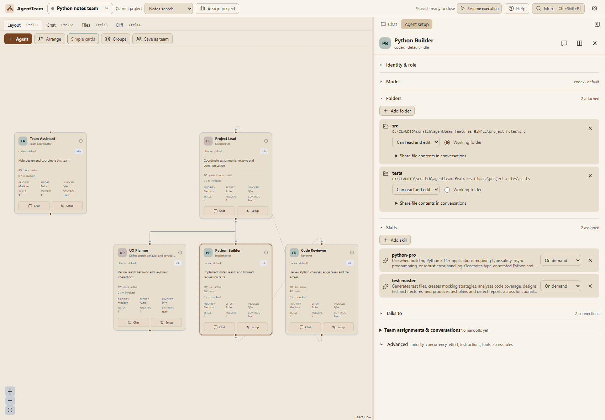
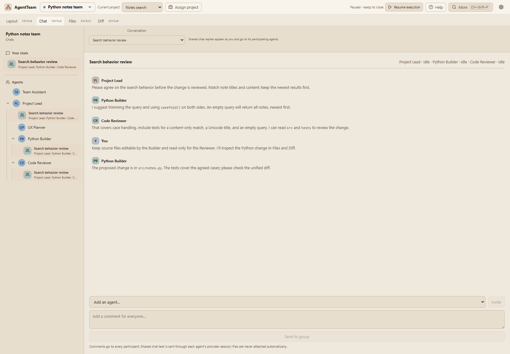
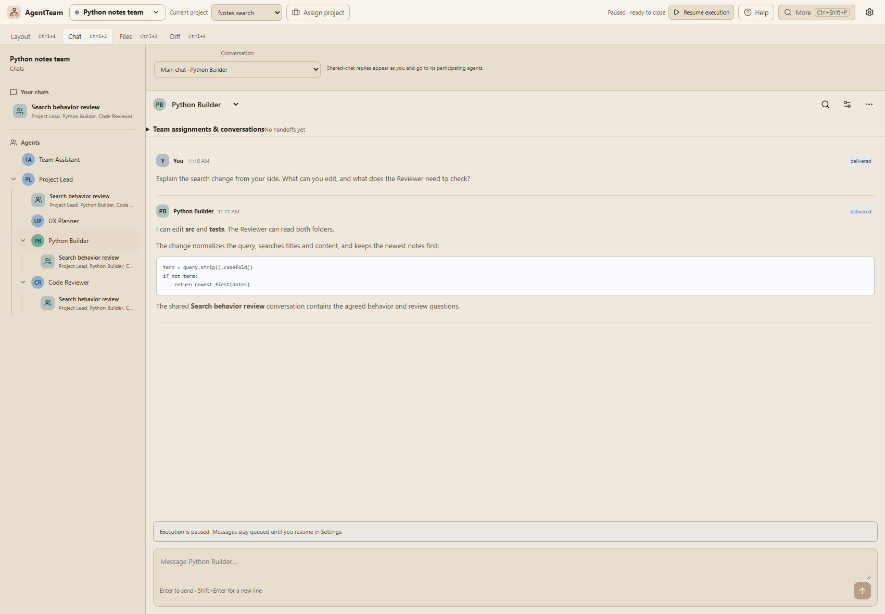
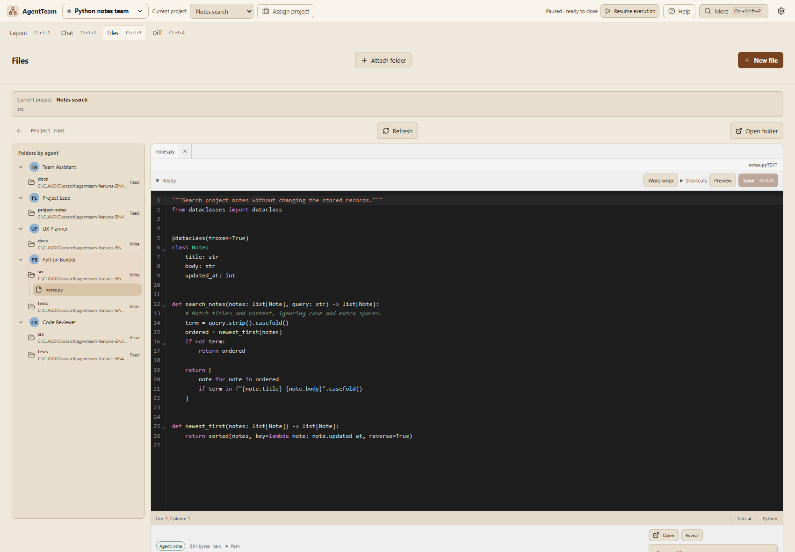
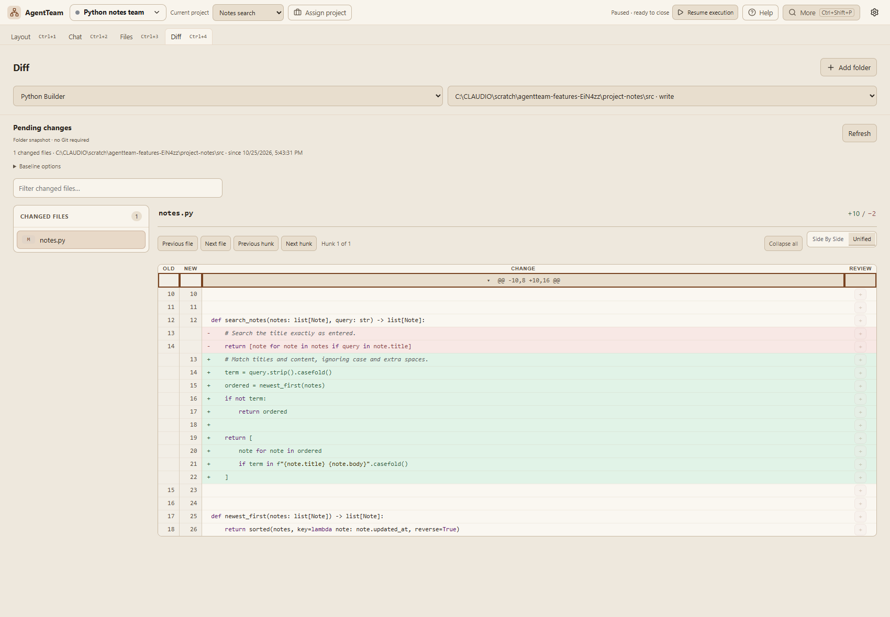

# AgentTeam

A desktop app for running teams of AI agents on your own machine.

## Disclaimer

Feel free to build it, change it, run your own teams on it, etc.

**This is a personal project to have some fun with claude code and codex, which generated essentially all of the code, and the rest of this readme:**

## Quick start / Install

1. Download from [GitHub Releases](https://github.com/chere005/AgentTeam/releases). Unsigned, so macOS and Windows ask before the first launch.
2. Install and sign in to the provider you want to use: Claude Code, Codex or wolframscript.
3. Open AgentTeam, insert an example team from the library, assign it a project.

## Platforms

- macOS (Apple silicon and Intel)
- Windows x64
- Linux x64 (AppImage and deb)

## Usage

A **team** is an org chart of agents. A **project** is a goal plus tasks that a team runs. Four main views, Cmd/Ctrl+1 to 4; everything else is a tab under More or Cmd+K.

### Layout

Set each agent's role, skills, folder access and who it talks to.

<picture></picture>

### Chat

Group chats with several agents. Follow their exchanges and reply to everyone.

<picture></picture>

Switch to any agent's own view of its conversations.

<picture></picture>

### Text editor

Browse the files each agent can read or edit, and edit them yourself.

<picture></picture>

### Diff

Review changes as a syntax-highlighted unified diff.

<picture></picture>

## Notes

- Execution is on by default; pause it in Settings if you don't want queued work to start.
- Not a sandbox: provider CLIs keep your OS permissions.
- Full feature list, limits and security notes: [docs/DETAILS.md](docs/DETAILS.md).

## Building

```sh
npm ci && node node_modules/electron/install.js
npm start                          # build and launch
npm test && npm run test:ui        # backend tests; Playwright against Electron
npm run package -- --publish never # installers for this platform
```

Node 24+. A `v*` tag builds the installers on GitHub; the release lane is in [docs/DETAILS.md](docs/DETAILS.md#releases).

## Documentation

- [docs/DETAILS.md](docs/DETAILS.md): everything the app does, provider setup, locking rules, limitations.
- [docs/ui-design.md](docs/ui-design.md), [docs/durable-execution.md](docs/durable-execution.md), [SIGNING.md](SIGNING.md).
- [AGENTS.md](AGENTS.md): rules for anyone, human or agent, changing the code. [TODO.md](TODO.md): the backlog.

## Contributing

Issues and pull requests are welcome. Read AGENTS.md first; `npm run typecheck`, `npm test` and `npm run test:ui` must pass. MIT, see [LICENSE](LICENSE).
