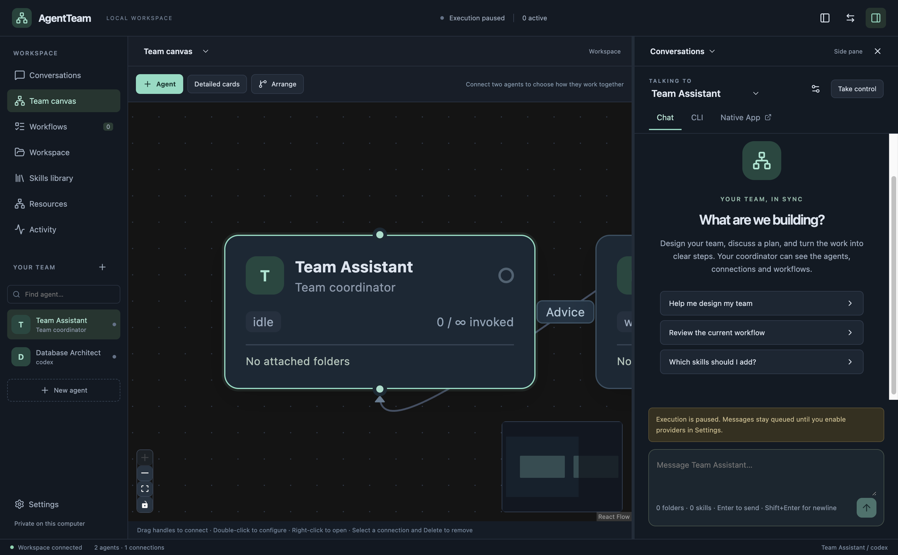

# AgentTeam

A local desktop workspace for building and coordinating teams of AI agents. Built with Electron, React, React Flow, TypeScript and SQLite. Targets **macOS, Windows and Linux**.

**0.1.0 is the first functional release.** The desktop UI and orchestration are implemented and tested with fixtures. Live provider integrations require your own installed runtimes and accounts; they have not all been validated against live subscriptions. Read the limitations below before running real work.



See [the detailed feature backlog](TODO.md) for remaining work, partial implementations, and the planned implementation order.

## Install

Download the appropriate artifact from [GitHub Releases](https://github.com/chere005/AgentTeam/releases).

- **macOS:** open the DMG and drag AgentTeam to Applications, or unpack the ZIP. Choose arm64 for Apple Silicon and x64 for Intel. This initial release is unsigned and not notarized; macOS may require approval in Privacy & Security after an initial launch attempt.
- **Windows:** run the x64 setup executable. This initial installer is unsigned; Windows may display a publisher warning.
- **Linux:** use the x64 AppImage (`chmod +x AgentTeam-*.AppImage`) or install the `.deb`. AppImage execution may require your distribution's FUSE package.

No provider credentials or subscriptions are bundled. AgentTeam does not replace the provider's terms, installation, login or billing.

## What is included

- A hideable navigation pane, main pane and resizable right pane. Canvas opens in the center and conversation on the right. Either content pane can show chat, cards, workflows, folders, skills, resource coordination or activity.
- Persistent agent profiles: environment, model, effort, role, instructions, skills, parent agent, scheduling priority and concurrent-invocation limit (Unlimited by default).
- An interactive team canvas with a plain-language connection editor and directed/bidirectional communication links, compact/detailed cards, hierarchy arrangement, zoom and directional activity pulses.
- Conversations with Enter-to-send / Shift+Enter-newline, a recipient dropdown, a persistent Team Assistant, queued messages, cancellation, CLI resume instructions and native-app opening on macOS.
- Workflow tasks, dependencies, completion criteria, pause/resume, retries, cancellation, and an automatic scheduler when execution is enabled.
- Priority-based routing rules, explicit routing previews and communication permissions. Role presets (coordinator, implementer, reviewer, adjudicator) set default access and output contracts. Rules can be advisory or mandatory: specialist rules match task text, tags or changed-file globs, every matching specialty is invoked with its evidence, and ties are shown rather than silently resolved. A mandatory rule is a required review: a backend-created review task must pass and approve the exact result before dependent tasks run (`review-required`); prompt text or an explicit recipient cannot bypass it. Changed-file evidence is what the task declares or reports, not measured from Git.
- Shared workflow state and artifacts: typed per-workflow fields with per-agent read/write permissions, versioned history attributed to agent/task/run, optimistic conflict detection, state carried in checkpoints, per-task fresh-memory runs, and a size-limited dependency/state context passed to downstream tasks as untrusted data. A task's structured state output is validated and committed atomically with its completion. Artifacts are immutable records with provenance and preview. Field definitions and per-task settings are API-only; the UI is a viewer.
- Run inspector: a correlated, filterable timeline of messages, tool calls, settings, transitions, locks and approvals; "why is this waiting?" explanations; clickable canvas transfers; routing/access previews; a fixture-only playground that runs saved examples against a copy of the team (never a live provider) and compares runs; and a redacted diagnostic bundle that excludes credentials, prompts (roles, instructions, goals; only length and hash), raw tool input, diff content, provider output and task results (length and hash only) and file contents; timeline entries are exported through an allow-list of ids, status/kind, a short title and file paths.
- Saved workspace layouts (Planning, Coding, Review, Monitoring and your own), an attention inbox for approvals, failures, blocked work and ready reviews, canvas groups with collapse and hierarchy navigation, keyboard shortcuts (press `?`), and accessible labels and focus handling for core forms and lists.
- Team Assistant change proposals: the assistant (or you) describes configuration changes as a strict list of operations (agents, connections, rules, workflows, stopping limits, folder attachments). Each proposal shows a before/after diff and flags significant effects; only you can approve, reject or apply it, a significant one needs explicit approval of exactly those operations, a proposal goes stale when anything it touches changes, and applying runs the same validation as the forms with full rollback on failure. Every step is audited. Ownership of each agent (team, embedded chat, CLI, native app) is explicit and one session is never driven twice.
- Skills, tools and knowledge: Always-load versus On-demand skills (on-demand ones are selected per request by AgentTeam, with the reason, version and approximate context cost recorded per run), change detection that keeps a changed skill out of runs until you accept it, an effective-instructions preview, an MCP tool registry with per-agent grants, environment-variable references instead of stored secrets and a metadata-only connection test, and per-agent/project knowledge sources (local lexical index, cited passages labelled as untrusted data, confined to attached folders and their access rules). Granted MCP servers are not yet passed to providers.
- Executable workflow graphs, separate from the communication graph: task, command, condition, human-input, fan-out/join and bounded-loop steps with typed inputs, static validation before a run, an immutable executed path and retry from the failed step. Command steps run without a shell (unless flagged), confined to an attached folder and its access rules, with a scrubbed environment, time/output bounds, the same limits, leases and effect ledger as tasks, and must be reviewed and confirmed before a run starts.
- Shared-resource locks for attached folders and overlapping subfolders. Workflow tasks and requested chat runs share the lock boundary. Priority ages while waiting so lower-priority agents eventually get a turn.
- Guided parallel workflow configuration: choose resources, a coordinator and a concurrency cap. The coordinator creates a plan that becomes a prerequisite for workers. Workers can be assigned disjoint files/folders (leased individually) or their own worktrees plus an integration task; writes outside an assignment or to a file another worker changed are detected after each worker and routed to the coordinator.
- Per-attachment access rules: grant or exclude individual files and subfolders, or grant only listed paths. Exclusions always win. They are enforced for browsing, previews, Git status/diff/history/staging, artifacts, knowledge sources, workflow-graph commands and file-change events; whole-tree Git changes (commit, pull, branch switch) are refused while an attachment has exclusions.
- An explicit Access view showing full folder paths, descendant access, read-only/read-write permissions, active directory, sharing, and provider permission limitations.
- File browsing with bounded typed previews (text, JSON, CSV/TSV tables, images, PDF and binary detection); Git status/diff/stage/unstage (including deleted directories, renames and new repositories)/commit and branch compare; opening files and project directories in Sublime Text, VS Code or the system application, with configurable editor executable paths. Folder listings and Git status refresh after external edits through a debounced file watcher.
- Git workflow panel: branch switch/create with confirmations for uncommitted changes and active runs, fetch, fast-forward pull, push with an explicit refspec and an explicit set-upstream action (never force), bounded commit history, a pull-request compare link built from the remote URL (no hosting API calls or tokens; PR status is what you record), and merge/rebase conflict listing, resolution, abort and continue. Remote failures are classified and explained in place.
- Isolated worktrees: create one from a base revision with a generated (overridable) branch and folder, attach it to the agent (optionally keeping the original repository attached), run an optional setup command with visible log and retry, see owner/branch/base/active tasks/changed files, and archive or remove it without discarding uncommitted work. An optional setting creates a worktree automatically for coding tasks created through the task API.
- Development servers: per-folder command/URL settings (package scripts are suggested, never run automatically), starting/ready/stopping/stopped/failed states with URL readiness checks, bounded logs and exit codes, whole-process-tree stop (also on quit), and an isolated preview restricted to the server's local origin, with viewport sizes, console errors and Open in browser.
- 28 bundled starter skills, plus three metadata-only recommendations. Installed harness skills are inventoried separately and grouped by environment. Sources, pinned revisions and licenses are preserved.
- Required validation gate: tasks marked `requiresValidation` stay queued until an immutable validation record shows a real `wolframscript` kernel run (version, output, exit 0, all assertions passing) for the exact inputs. At most two validation runs execute at once. Agent agreement or generated code alone never opens the gate. A paused Wolfram-validated sample exists; it needs your model mappings before it can be resumed.
- Per-workflow limits (runtime, agent turns, handoffs, retries, spawned agents, reported tokens, children per task, delegation depth/loops) with a consumption view in the workflow UI. A tripped limit pauses the workflow, aborts running tasks and records the reason; raise the limits to resume. Tasks can also carry completion checks that the backend enforces against the exact result (there is an API for them but no editor in the UI yet).
- Code review viewer: unstaged, staged and branch/commit compare views (merge-base optional, revisions resolved to SHAs), line comments that become outdated when their hunk changes, per-file reviewed marks and an approve/request-changes decision. Review never runs Git mutations.
- Team templates: save a team as a portable template, export/import it, and insert it atomically with ID remapping and workspace mapping. Four bundled starters (implementation and review, database work, research, Wolfram computation) use the same preview/insert path. Templates carry no secrets or running processes.
- Runtime diagnostics and a capability table in Settings: per-runtime scan results, manual-path overrides, reset/rescan, and an explicit statement of what each adapter (Codex CLI, Claude Code CLI, wolframscript, ACP) supports. Direct-CLI work waits (`runtime_resolving`) until a scan settles, then fails with `runtime_unavailable` if no runtime is found.
- Local persistence, authenticated loopback API, durable activity events, immutable task checkpoints and an effect ledger. After a restart, running tasks become `interrupted` (resume from the last checkpoint without spending a retry) or `blocked` when an external effect's outcome is uncertain and needs your decision; completed provider output is never re-run. Pending permission requests survive a restart. A Recovery panel in each workflow shows the checkpoint and what runs next; per-task retry policy with backoff is set through the API (`PUT /tasks/:id/retry-policy`, no editor yet). See [docs/durable-execution.md](docs/durable-execution.md).

## Run from source

Install Node.js 24 or newer, then:

```sh
npm ci
node node_modules/electron/install.js
npm start
```

`npm start` builds and launches the desktop app. `npm run build` only builds. `npm run backend` starts the standalone API. `npm run package -- --publish never` creates installers for the current platform. GitHub Actions checks macOS, Windows and Linux and builds installers for release tags.

Development UI: run `npm run dev:ui`, build the desktop entry once, then launch Electron with `AGENTTEAM_DEV=1`. Windows PowerShell uses `$env:AGENTTEAM_DEV="1"; npm run desktop`.

## Hybrid backend

AgentTeam owns routing, scheduling, priorities, resource locks, and persistent team/workflow state in TypeScript and SQLite. Provider execution has direct CLI adapters and an optional ACP v1 adapter using the pinned `@agentclientprotocol/sdk` 1.9.0 (Apache-2.0). ACP is a connection layer, not a replacement for orchestration. Durable checkpoints and the effect ledger are engine-agnostic SQLite entities; the XState/LangGraph evaluation is still open and neither is installed.

Settings → Agent connections selects Direct CLI or ACP for each provider. ACP requires an installed adapter executable (or Node plus an adapter script argument). It negotiates capabilities, streams output, handles permission requests, and reloads sessions where supported. Existing conversations are bound to their adapter identity: create a new agent when changing transports or adapter commands. ACP fixture tests pass; live Codex/Claude account compatibility is not yet verified. Internal Wolfram ACP support is deferred.

ACP client filesystem/terminal capabilities are currently disabled. The adapter's native tools still use its own local permissions; this is not an OS sandbox or enforcement of native-subagent limits. AgentTeam shows pending permissions and maintains its own scheduling/resource gates. Provider-native background jobs and crash recovery need further work.

## Provider setup

Execution is on by default (the desktop app outside test mode, and the standalone backend unless `AGENTTEAM_ENABLE_LIVE=0`), with Pause/Resume controls in Settings; once you pause or resume, the desktop app remembers that choice across restarts. Queued work from earlier sessions can therefore start as soon as a runtime is ready, so pause first if you do not want that. Existing provider installations are discovered automatically; manual executable overrides remain available. Authenticate the chosen provider separately. Eligible queued tasks run automatically while execution is active; chat requests are scheduled when sent or explicitly run.

- **Codex:** install/authenticate the Codex CLI and make `codex` available on PATH. The initial adapter uses read-only execution. Model and effort values pass through to the installed CLI.
- **Claude:** install/authenticate Claude Code and expose `claude` on PATH. The initial adapter is tool-free chat; On-demand skills are selected by AgentTeam per request (the model cannot load them itself). Its CLI flags require a sufficiently recent installation.
- **Wolfram:** install `wolframscript` and configure Wolfram LLM access. The adapter uses a fixed `LLMSynthesize` script with a private temporary JSON request file. Model `default` uses the installation default; a named evaluator such as `WolframAIAssistant` can be configured if available. `AGENTTEAM_WOLFRAMSCRIPT` can override the executable path. This bridge has not been live-account validated.

On Windows and Linux, Sublime's `subl` or VS Code's `code` command must be on PATH for editor launching. Native provider-app launch is currently implemented for macOS; CLI resume instructions are cross-platform. The CLI view provides commands, not an embedded interactive terminal.

## Resource access and coordination

AgentTeam's file browser and Git operations enforce the attached folder boundaries and read/write setting, block path traversal and symlink escapes, and exclude direct `.git` access. Folder permissions include descendants. External editor opening is a user action.

The scheduler locks each agent's attached folders for the duration of a run, or only the files/folders a task declares (`resourcePaths`). Tasks and chat runs share one queue ordering. After a crash, a lease whose provider process may still be running stays "draining" (no second writer) until that process exits; Resources offers an explicit force release once you have confirmed it stopped. Overlapping paths conflict by default. A named resource can override an agent's scheduling priority: Low, Medium, High, Max, or Preempt. Normal priorities gain one effective point per five seconds waiting; Preempt gets the next available turn ahead of normal work. Running work is never interrupted. Existing numeric priorities retain their values; old 100 remains Max, while Preempt uses 101. Continuous Preempt traffic can delay normal work. This provides eventual priority over newer work, not a fixed wall-clock start guarantee.

In Resources, configure a workflow for parallel access by naming a coordinator, shared resources and a cap. Its coordination task runs first and passes a work-allocation plan to the workers. Assigned paths are disjoint and leased per worker; conflicting writes are detected afterwards (by comparing changed files), not prevented while a provider runs, and nothing is merged automatically. Separate worktrees give the strictest isolation.

These locks do **not** control external CLI/native-app sessions or external editors. Provider filesystem scope is also separate: Codex's current sandbox may read outside attached folders; Claude's current adapter disables tools. The Access pane states these differences explicitly.

## Current limitations

- This is an early release, not a fully isolated agent sandbox. Per-file rules and exclusions govern AgentTeam's own file, Git, knowledge and command paths; provider CLI processes, native apps, external editors and the programs a command step runs keep your own OS permissions. No automatic conflict merging.
- Team Assistant proposals are read from fenced `agentteam-proposal` blocks in its replies (or created in the Assistant changes pane) and applied only by you; the assistant has no tool to apply anything and no provider tool endpoint exposes proposals. Saved-team insertion and deleting agents/rules are not proposal operations yet.
- Routing rules select recipients through the routing API/preview. Teammate-invocation tool definitions and handlers exist, but they are not yet exposed to provider runs, so providers cannot autonomously invoke teammates as native tools.
- Native-app handoff may open a separate conversation. CLI resume continuity depends on the provider. Wolfram uses recent transcript context instead of a persistent remote session.
- Provider chat runs default to a 180-second timeout and 4 MB of output; workflow tasks default to 30 minutes and 16 MB. Override with `AGENTTEAM_{CHAT,TASK}_{TIMEOUT_SECONDS,MAX_OUTPUT_MB}`. After a restart, interrupted tasks wait for an explicit Resume; nothing re-runs by itself, and automatic retries of failed tasks are opt-in per task. Recovery is fixture- and crash-simulation-tested only: resuming a recorded provider session has not been verified against live providers, and effects are recorded only where AgentTeam observes them (provider runs, chat runs, ACP tool calls).
- Token usage is shown only when the provider reports it (fixture-tested parsing; Wolfram and ACP report none); cost is always shown as unavailable.
- The validation gate and the Wolfram sample have been tested with a fake kernel; the real-kernel smoke test (`AGENTTEAM_WOLFRAM_SMOKE=1`) is opt-in and has not been run. Nothing in the sample has run against live providers.
- Previews are bounded (text 256 KB, JSON 1 MB, images 4 MB, CSV 200 rows × 30 columns); other binary files open externally. Pull is fast-forward only by default; merges and rebases are not started from the UI, but conflicts from one are listed and resolved there. Pull-request status is not fetched from hosting services. Open file/project/reveal and the file watcher are verified on macOS only.
- Worktree and development-server process handling is tested on macOS only; Windows (`taskkill /T`) and Linux paths run in CI but are not otherwise verified. Servers that daemonize themselves escape the process group and are not stopped. Development servers are not restarted after an app restart (state is not persisted, so a dead server is never shown as ready), and a hard crash of the app can leave a server running. The embedded preview and its console capture need the desktop app.
- Developer ID signing and notarization are supported; see [SIGNING.md](SIGNING.md). Builds without configured credentials are unsigned. No automatic update distribution yet. Windows/Linux validation is performed in CI, not on this macOS development machine; Windows command-shim launching (`.cmd`/`.bat`) is fixture-tested only. No versioned database migrations or backup/restore tooling yet.

## Data and security

Desktop state uses Electron's application-data directory (`~/Library/Application Support/AgentTeam` on macOS, `%APPDATA%/AgentTeam` on Windows, `$XDG_CONFIG_HOME/AgentTeam` or `~/.config/AgentTeam` on Linux). `AGENTTEAM_DATA_DIR` overrides it. The standalone backend defaults to `.agentteam/` in the project and writes its bearer token to `.agentteam/api-token`. Do not publish these directories.

The renderer is sandboxed with context isolation, no Node integration, a restricted content security policy and sender-validated IPC. The local API rejects browser origins and requires a bearer token kept in the main process. Prompts are passed as data, not shell commands. Git commits, pulls and pushes run with repository hooks disabled and without terminal credential prompts.

## Tests

```sh
npm run typecheck
npm test
npm run build
npm run test:ui
```

Desktop tests launch Electron with an isolated temporary database and never call live providers. Linux UI tests need a display, e.g. `xvfb-run --auto-servernum npm run test:ui`.

## Licensing

AgentTeam source is MIT. Run `node scripts/audit-release.mjs` for a consistency check of the lockfile, bundled skill notices and team templates; see [docs/RELEASE_CHECKLIST.md](docs/RELEASE_CHECKLIST.md). Bundled skills retain their upstream MIT or Apache-2.0 notices under `assets/skills`. `assets/recommended-skills.json` records source and compatibility information. Electron includes its own third-party notices in packaged applications. Claude, Codex-hosted services and Wolfram runtimes/accounts are separate products; an open-source app license does not grant access to them.
